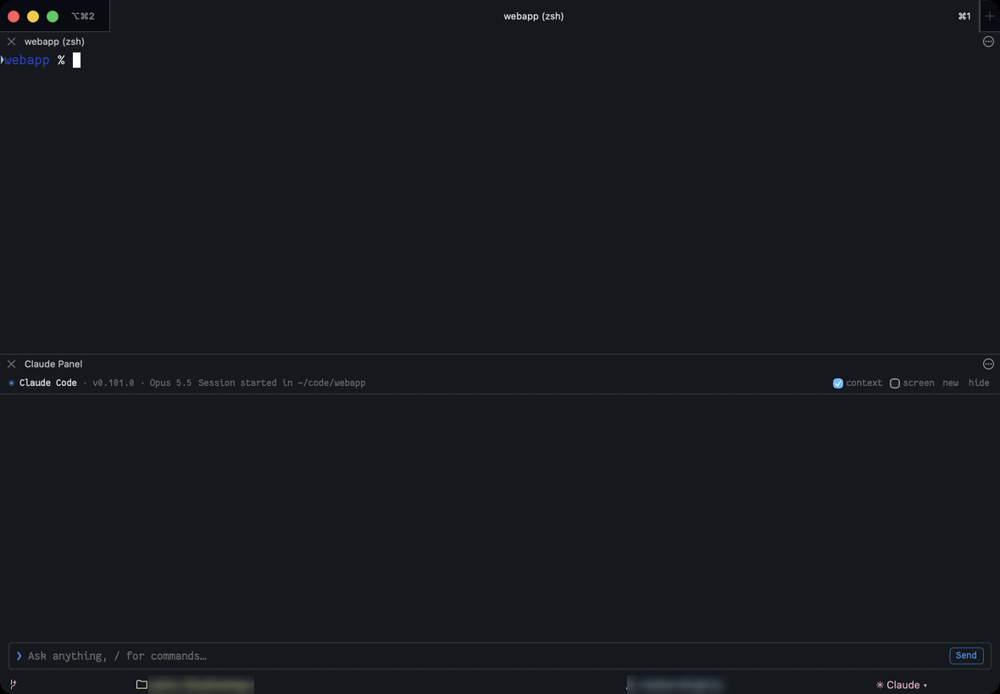
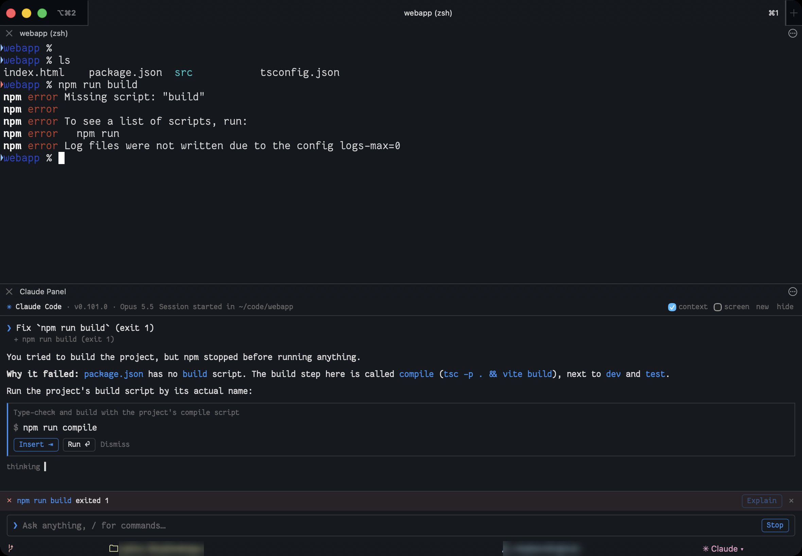

# Intelligent iTerm

[](https://github.com/mika76/intelligent-iterm/actions/workflows/tests.yml)

**A Claude Code side panel for iTerm2.** It sees your terminal, explains failed commands,
and proposes fixes you can insert or run with one click.



Inspired by Microsoft's [Intelligent Terminal](https://github.com/microsoft/intelligent-terminal),
built for iTerm2 on macOS. It runs as an iTerm2 Python API script and talks to Claude Code
through the [Agent Client Protocol](https://agentclientprotocol.com), using your existing
Claude Code login. No API keys are stored.

> **Status: 0.2, an early release.** Tested on iTerm2 3.7.7 only. Expect rough edges, and
> see [Known limitations](#known-limitations).

## Quick start

1. In iTerm2, enable **Settings > General > Magic > Enable Python API**, install
   **Scripts > Manage > Install Python Runtime**, and install shell integration
   (**iTerm2 > Install Shell Integration**).
2. Make sure Node.js ≥ 22 and [Claude Code](https://docs.claude.com/en/docs/claude-code)
   are installed, and that you've logged in to Claude Code once.
3. Clone and install:

   ```bash
   git clone https://github.com/mika76/intelligent-iterm.git && cd intelligent-iterm && ./install.sh
   ```

4. In iTerm2, run **Scripts > AutoLaunch > intelligent_iterm_panel.py**, then press
   **Ctrl+Shift+.** in any tab to open the panel below the terminal.

Details are under [Requirements](#requirements) and [Install](#install).

## How it works

```
iTerm2 pane / toolbelt (webview) ──HTTP/SSE──▶ intelligent_iterm (Python, iTerm2 API script)
                                                 │  reads sessions, watches prompts, types text
                                                 └─stdio JSON-RPC (ACP)─▶ claude-agent-acp ─▶ Claude Code
```

- **Agent:** Claude Code via [`@agentclientprotocol/claude-agent-acp`](https://github.com/agentclientprotocol/claude-agent-acp)
  (the renamed successor of `@zed-industries/claude-code-acp`), pinned in `package.json`.
- **Script:** standard library plus the `iterm2` package only, so it runs on iTerm2's basic
  Python runtime. The chat UI is a single HTML file with no build step.

## Features



1. **Chat panel** with streamed replies, in either of two places:
   - **Docked below the terminal** (like Intelligent Terminal's agent pane). Open or close
     it for the current tab with **Ctrl+Shift+.**, the status bar button (**⬓ Claude Code ▴**, showing the tab's agent),
     `hide` in the panel, or `dock ↓` in the toolbelt. To add the button, go to iTerm2 >
     Settings > Profiles > Session > *Configure Status Bar* and drag in **Agent panel**.
     It only appears in the picker while the script is running. It's an iTerm2 browser split pane, created with per-session settings,
     so no profile is added to your iTerm2 config. The script hides the pane's browser
     URL bar through iTerm2's API (3.7.7 and later). On older iTerm2 it presses
     **Web > Show Toolbar** through macOS accessibility instead. The first time, macOS may ask to let iTerm2 control
     System Events and use Accessibility. If you decline, the URL bar stays; you can hide it
     yourself with Web > Show Toolbar, or set `INTELLIGENT_ITERM_KEEP_BROWSER_TOOLBAR=1`
     to skip the step.
   - **In the toolbelt** on the right (View > Toolbelt > Claude).

   **Each tab has its own conversation**, with its own Claude Code process. A tab's
   docked panel always shows that tab's conversation; the toolbelt shows the active
   tab's and switches when you change tabs. Closing a tab ends its conversation.
2. **context** (header, on by default) sends the active session's directory, shell, window
   title, last command, exit status and output with each message, as JSON. If shell
   integration has no command history, it sends the last 60 lines of the terminal instead.
   **screen** also attaches the visible screen once, with the next message. Claude can
   also read the terminal itself with its `read_terminal` tool.
3. **Explain / fix**: when a command in the active session exits non-zero, a status bar
   above the input shows it with an **Explain** button (or type `/explain`). Claude works
   out what you were trying to do, says why it failed, and proposes the corrected command,
   or asks when the goal isn't clear.
4. **Proposed commands**: Claude proposes a command with its `propose_command` tool, and
   the panel shows it as a card with **Insert ⇥** (type it at your prompt, no Enter),
   **Run ⏎** (type it and press Enter), **What does this do?** and **Dismiss**. Claude
   is told which you chose. *What does this do?* asks, as your next message, for an
   explanation of each part and flag and what it changes or deletes; Claude then proposes
   the command again, or a safer variant such as a dry run.
   Commands only go to your terminal when you click. Destructive commands (`rm -rf`,
   `sudo`, force-push, `git reset --hard`, `curl … | sh` and the like) get a red warning
   saying what they do, and **Run** needs a second click. Multi-line commands (heredocs,
   loops) go in as one bracketed paste, so they wait in the shell's buffer until you press
   Enter; that's only done in zsh and fish, and only when the shell itself is in front
   (not a REPL or other program). Control characters are refused. Commands in `bash`
   blocks also get Insert and Copy.
5. **/ commands**: type `/` for the panel's own (`/new`, `/explain`, `/screen`, `/hide`,
   `/doctor`) and Claude Code's (your skills and custom commands).
6. **Setup checks**: when the panel opens it checks Node, the adapter, the Claude Code
   login and shell integration, and shows anything that needs fixing with the fix.
   `/doctor` shows the full report.

The header shows the agent and its version, like Intelligent Terminal's pane, and
dropdowns for the **model**, **mode** and **effort**. A change applies to every tab using
that agent, and is remembered for new tabs and the next run (in
`~/Library/Application Support/intelligent-iterm/settings.json`).

### Other agents

Claude Code is the default, but the panel speaks the
[Agent Client Protocol](https://agentclientprotocol.com), so other ACP agents work too.
When **Gemini CLI** (`gemini --acp`), **OpenCode** (`opencode acp`) or **GitHub Copilot**
(`copilot --acp`) is installed, the agent name in the header becomes a dropdown. Picking
one starts this tab's conversation over with that agent and makes it the default for new
tabs; other tabs keep theirs. Sign in to each agent's CLI once in a terminal first.

Other ACP agents can be added in the settings file:

```json
{"agents": [{"id": "codex", "name": "Codex", "command": ["npx", "@zed-industries/codex-acp"]}]}
```

Agents other than Claude Code get the panel's instructions in their first message (ACP
has no standard system prompt), and use the same `propose_command` and `read_terminal`
tools over MCP. How well they use them depends on the agent and model.

The agent prompts (system prompt and the Explain/fix instructions) are adapted from
[Microsoft Intelligent Terminal](https://github.com/microsoft/intelligent-terminal)'s
`terminal-agent.md` and `auto-fix.md` (MIT). Its tools reach the panel through a small
MCP server at `/mcp` on the panel's local server.

Typing anywhere in the panel goes to the input, even after you've clicked a message,
a card or a button; ⌘V pastes there too. Shortcuts such as ⌘C on selected text still work.
Sending a message scrolls back to the bottom.

Cards work from the keyboard, like Intelligent Terminal's pane: **↑** in the empty input
selects the newest card waiting for an answer, **←/→** move between its buttons,
**Enter** presses the selected one, and **Esc** (or just typing) leaves the card. On a
permission card, **Y** allows and **N** denies. The cursor stays in the input throughout.

The panel takes its colors and font from the active session's iTerm2 profile, and updates
when you switch to a session with a different profile, so it looks like part of the terminal.

Claude's own tool use (reading files, running commands in its own process) starts in
Claude Code's **Manual** permission mode: each tool call shows Allow/Reject buttons in the
panel. The mode dropdown switches to Accept edits, Plan or Auto; Bypass permissions isn't
offered in the panel.

## Requirements

- A recent iTerm2 (only tested on 3.7.7; prompt IDs and command-end notifications need a modern build)
- **Python API enabled:** iTerm2 > Settings > General > Magic > *Enable Python API*
- **Shell integration** installed (iTerm2 > Install Shell Integration). It is needed for
  failed-command detection and per-command output.
- **iTerm2 Python runtime:** Scripts > Manage > *Install Python Runtime*
- Node.js ≥ 22 (nvm, Homebrew or /usr/local are all found automatically)
- Claude Code installed and logged in (`claude` once, then `/login`)

## Install

```bash
./install.sh
```

This runs `npm ci` for the adapter, checks the setup, and writes a small launcher to
`~/Library/Application Support/iTerm2/Scripts/AutoLaunch/intelligent_iterm_panel.py`.
The launcher points back at this folder, so keep the folder where it is.

Then in iTerm2:

1. **Scripts > AutoLaunch > intelligent_iterm_panel.py** to start it now (it also starts
   automatically whenever iTerm2 launches).
2. **View > Toolbelt > Claude** to add the panel to the toolbelt.
3. **View > Toolbelt > Show Toolbelt** (⇧⌘B) to show it.

Starting the script again (for example after an update) is safe: running it from the
Scripts menu starts a new copy, and any older copy exits within a couple of seconds.

To remove it: `./install.sh uninstall`.

If something doesn't work, check the setup from a shell, or type `/doctor` in the panel
for the checks that need iTerm2:

```bash
python3 -m intelligent_iterm.doctor
```

Logs go to `~/Library/Logs/intelligent-iterm.log`. iTerm2's Scripts > Manage > Console
also shows the script's output.

### Configuration (environment variables, all optional)

| Variable | Purpose |
|---|---|
| `INTELLIGENT_ITERM_NODE` | Path to `node` if auto-detection fails |
| `INTELLIGENT_ITERM_CLAUDE` | Path to the `claude` CLI to use |
| `INTELLIGENT_ITERM_KEEP_BROWSER_TOOLBAR=1` | Leave the URL bar visible in the docked pane (skips the accessibility click) |
| `INTELLIGENT_ITERM_PORT` | Fixed port for the local server (default: random) |
| `INTELLIGENT_ITERM_KEEP_API_KEY=1` | Keep `ANTHROPIC_API_KEY` in the agent's environment. By default it is removed so the panel uses your Claude Code login rather than billing an API key. |

## Development

```bash
python3 -m unittest discover -s tests        # bridge tests with a fake agent (no tokens)
```

```bash
python3 tests/dev_server.py                  # UI in a normal browser at http://127.0.0.1:8765/?t=dev
```

```bash
python3 tests/dev_server.py --real           # same, with real Claude Code
```

```bash
python3 -m venv .venv && .venv/bin/pip install -r requirements-dev.txt
```

```bash
.venv/bin/python tests/live_iterm_check.py   # live check: opens an iTerm2 window, runs a failing ls, closes it
```

```bash
.venv/bin/python tests/live_dock_check.py    # live check: docks the panel in its own window, then closes it
```

```bash
.venv/bin/python tests/live_tabs_check.py    # live check: per-tab conversations in a two-tab window
```

```bash
.venv/bin/python tests/live_focus_check.py   # live check: typing off-focus, and a card by keys (presses keys)
```

```bash
.venv/bin/python -m intelligent_iterm.main   # run the panel from a shell instead of AutoLaunch
```

| File | What it does |
|---|---|
| `intelligent_iterm/main.py` | Entry point: starts the server, registers the toolbelt tool, watches sessions |
| `intelligent_iterm/dock.py` | Bottom-docked browser split and the Ctrl+Shift+. shortcut |
| `intelligent_iterm/terminal.py` | iTerm2 API: context, failed-command detection, safe insert |
| `intelligent_iterm/panel.py` | Turns UI actions into ACP prompts and agent updates into UI events |
| `intelligent_iterm/acp.py` | Minimal ACP (JSON-RPC over stdio) client |
| `intelligent_iterm/mcp.py` | Minimal MCP server for the agent's `propose_command` / `read_terminal` tools |
| `intelligent_iterm/web.py` | Local HTTP + Server-Sent Events server |
| `intelligent_iterm/settings.py` | Remembered agent and header choices, custom agents |
| `intelligent_iterm/safety.py` | Warnings for destructive commands; when multi-line paste is safe |
| `intelligent_iterm/doctor.py` | Setup checks behind `/doctor` and the installer |
| `intelligent_iterm/config.py` | Finds node, claude and the adapter outside your shell's PATH |
| `intelligent_iterm/static/index.html` | The chat UI (no build step) |

## Security notes

- The server listens on 127.0.0.1 only. Every API call and the event stream require a
  random token generated at each launch, and requests with a foreign `Host` header are
  rejected. Without this, any web page in your browser could make the panel type into
  your terminal.
- The agent's MCP endpoint (`/mcp`) needs the same token; it's passed to Claude Code in
  the session's MCP config, not stored anywhere. Its two tools are pre-allowed for that
  session only, because they ask you themselves.
- Nothing is typed into your terminal without a click. Insert never sends Enter; Run sends
  Enter once, for the command shown on the card, and asks for a second click when the
  command looks destructive. That check is a pattern list, not a sandbox: read what you run.
- Insert and Run only type at a waiting shell prompt. While a command, REPL or editor
  is running in that terminal they're refused with a message, so keystrokes never go to
  the wrong program or sit half-consumed in the input queue.
- Multi-line text is only sent as a bracketed paste, and only to zsh or fish when the shell
  is the foreground job; otherwise it's refused, so lines can't run one by one. Other
  control characters are always refused.

## Known limitations

- **Docking:** the toolbelt only goes on the right. The bottom dock splits the *active pane*,
  not the whole tab, because the API can't split a tab's root. With several panes in a tab
  it sits under the one you were in. The pane is created the first time you open it in a
  tab, where the new pane shows blank for about a tenth of a second before its page draws (WebKit's first paint; the window itself stays in the terminal's colors); after that, hiding it maximizes the
  terminal pane (View > Maximize Active Pane) so the panel stays loaded and reappears
  instantly. Typing `exit` in the terminal closes the panel with it. Because the tab has
  two panes, iTerm2 asks before closing it with ⌘W. It opens at iTerm2's default split (about half),
  and the window keeps its size; drag the divider to change it. Setting a size from the
  script isn't reliable: terminal panes are sized in rows and browser panes in points, and
  iTerm2 resizes the window to reconcile them. The dock depends on iTerm2's browser profiles (tested on 3.7.7; the
  `browserProfiles` advanced setting, on by default).
- **The docked panel grays out when it isn't focused.** iTerm2 dims inactive browser panes
  with a gray overlay and ignores "Dimming affects only text" for them. Only the global
  settings under Settings > Appearance > Dimming change this: lower *Dimming amount*, or
  untick *Dim inactive split panes*.
- **Ctrl+Shift+.** is captured from every terminal session while the script runs, so
  programs in the terminal no longer receive it.

- **One agent process per tab.** Each starts in the active session's directory when you
  open the panel or send the first message in that tab. "New chat" starts a fresh one, for
  example after you `cd` elsewhere. Several tabs with open panels mean several Claude Code
  processes.
- **"Active session"** means the focused terminal in the frontmost iTerm2 window. When you
  are typing in the docked panel, it means the terminal you last used in that tab. Insert
  goes there and focuses it, which is not necessarily the session the failure came from.
- **Failure cards** appear in the conversation of the tab the command ran in, even if
  that tab isn't active, and only with shell integration (OSC 133 marks). Commands that ran before the script started
  are still used for context, via prompt history.
- **Output capture** is limited to the last 200 lines of a command, and to whatever is
  still in scrollback. Full-screen apps (vim, less, top) don't produce usable output.
- **Conversation history** lives in memory. Reloading the panel replays it, but
  restarting the script or iTerm2 clears it. Sessions are not resumed (`session/load`).
- **Markdown rendering** covers what Claude normally writes (headings, lists, task lists, quotes,
  tables, links, code, bold/italic/strikethrough) but isn't a full CommonMark parser. Links
  open in your default browser.
- **Permission prompts** only offer the options the adapter sends. There is no per-tool
  settings UI. Sessions start in Manual mode (or the mode you picked in the header),
  not your Claude Code default.
- **First message cost:** Claude Code loads your usual configuration (CLAUDE.md, skills,
  MCP servers), so the first turn has a sizeable cached prompt.
- **Other agents** are tested lightly: OpenCode and GitHub Copilot connect, show their
  options and use the panel's tools; Gemini CLI needs its own sign-in before it starts.
  Their permission prompts, modes and slash commands are whatever the agent sends.
- **Split panes in one tab** share that tab's conversation; the context comes from the
  pane you last used.

## License

[MIT](LICENSE). The agent prompts are adapted from Microsoft Intelligent Terminal (MIT);
its notice is included in the license file.
